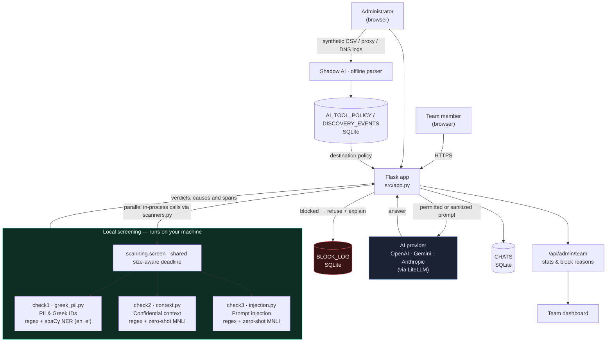

# CyberSyn — AI Security Gateway

**Shadow AI protection & Data Protection** · Netcompany Hackathon Athens 2026 · Challenge 3

> Employees paste code, contracts and client data into public AI tools every day, often without IT knowing.
> For prompts sent through CyberSyn, the member’s policy runs **on the gateway** before forwarding.
> Enabled rules can warn, redact or block; administrator exceptions are audited without logging private text.
> Shadow AI makes imported usage and workspace AI tool policy inspectable without contacting the logged destinations.

---

## Contents

- [Key features](#key-features)
- [Architecture](#architecture)
- [The three scanners](#the-three-scanners)
- [Policy actions](#policy-actions)
- [Shadow AI discovery](#shadow-ai-discovery)
- [Quick start (Docker)](#quick-start-docker)
- [Local development](#local-development)
- [Configuration](#configuration)
- [Security & privacy design](#security--privacy-design)
- [Testing & evaluation](#testing--evaluation)
- [Project layout](#project-layout)
- [API reference](#api-reference)
- [Limitations & roadmap](#limitations--roadmap)

---

CyberSyn is a self-hosted **AI gateway for teams**. Team members chat with the AI model of their choice
through CyberSyn; administrators define what must never leave. The server applies the member’s enabled local
rules before sending. When a rule pauses or blocks a prompt, the member can see what matched and why, without exposing the text to an administrator.

Design principles:

1. **Local first.** Scanning happens on the machine running CyberSyn. Prompts are never shipped to a
   third-party DLP service for inspection — that would just move the leak.
2. **Fail closed.** If a scanner crashes or times out, the request is refused. A broken gate is never an
   open gate.
3. **Explain, don't just block.** Local findings include the category, line and matched span. Destination blocks name the unapproved tool.
4. **Humans stay in control.** An administrator can approve a genuine exception; the override is recorded
   and attributed, not silently allowed.
5. **Minimise audit data.** A blocked snippet is shown to its sender. The logs retain the stage,
   reason, actor and time, not the snippet. Ordinary prompt previews are off by default.

## Key features

**Protection**

- Four independent rules backed by [three scanners](#the-three-scanners): personal/Greek identifiers,
  confidential company context, prompt injection and source code.
- Greek-aware & international detection: **AFM** (with checksum validation), **AMKA**, **passport numbers**
  (context-scored Greek & international formats), **IPv4 addresses** (private/contextual), Greek and international
  phone numbers, Greek and Latin company suffixes, plus person names (initials, hyphenated names, and inflected
  Greek surnames) via regex + dual spaCy NER models.
- Credential and secret detection: DB connection strings, private keys, IBANs, `sk-`/`AKIA` keys, inline
  `password=`/`token=` assignments.
- Prompt-injection detection that reads code comments too — multi-line comment blocks are merged so an
  attack split across lines is still caught, alongside zero-width character, homoglyph, and base64 obfuscation checks.
- Per-member **Allow, Warn, Redact & send or Block** policies, with optional local reply restoration.
  Code alone is allowed by default. Workspace defaults seed new members; they do not rewrite existing policies.

**Governance & visibility**

- Shadow AI (`/shadow-ai`): inspect tool risks and GDPR considerations, set statuses or add custom domains,
  see which teams' synthetic log records indicate sensitive data going to unapproved AI tools, and export CSV/JSON compliance reports.
- OpenAI-compatible proxy (`/v1/chat/completions`, `/v1/models`): external tools, IDE assistants and in-house AI apps
  can point their OpenAI base URL at CyberSyn using a seat token and inherit Shadow AI policy, DLP/PII screening,
  redaction, and audit logging.
- Independent **Team member** and **Administrator** sign-in tabs, with direct links to the administrator dashboards.
- Administrator Team (`/team`) & Statistics (`/stats`): configure workspace defaults and per-member seats directly
  from `/team`, inspect per-member totals, reasons, trends and a timestamped activity log, and export CSV/JSON reports.
- Block log persisted in SQLite and attributed to a member and a stage.
- Admin-approved override: a blocked prompt can be released by entering the administrator password; the
  exception is attributed in the audit trail.
- Full multi-chat history: create, open, rename and delete chats, restored on login.

**Platform**

- Bring your own model: OpenAI, Google Gemini or Anthropic through LiteLLM, with live model discovery
  from the provider (paste a key, pick a model from the list).
- Bilingual interface — English and Greek, switched at runtime and preserved across pages.
- Runs entirely in Docker with one command; no external database to provision.

## Architecture



**Request lifecycle**

1. The browser posts a prompt to `POST /api/admin/employee/chat`, with its HttpOnly member cookie and CSRF header. API clients may use a body token.
2. The server authorises the caller — the member's own token, and an administrator's token as well
   when the request is an override. Unauthorised calls are refused before any work is done.
3. CyberSyn resolves the saved model, provider and base, and checks the current destination policy.
4. `scanning.screen()` runs enabled rules via `scanners.py` against one shared deadline (45 seconds for short prompts, up to 180 seconds for larger pastes by default).
   Loaded models are reused. A missing import can use the serialized subprocess fallback; an invalid, failed or timed-out check stops the send (`503`).
5. Enforce block → warn → redact → allow in that order. Findings can be shown to the member; only audit metadata is written for stopped or flagged sends.
6. Only a permitted or sanitized prompt is forwarded. Regeneration follows the same path. Redacted history saves the sanitized prompt and unrestored answer.

## The three scanners

| # | Script | Detects | Technique | Triggers when |
|---|---|---|---|---|
| 1 | `src/MLscripts/greek_pii.py` | AFM checksum, AMKA date, Greek ID & passport context/format, IPv4 (private/contextual), IBAN mod-97, Greek & international phones, emails, modern provider/access keys, companies and names (EN + EL) | Regex with checksum & context scoring, plus spaCy `en_core_web_sm` / `el_core_news_sm` NER | A PII match scores ≥ 0.80 |
| 2 | `src/MLscripts/context.py` | Credentials/banking, passports, IPv4s, legal contracts & NDAs, internal financials, HR/payroll/customer dumps, source code | IBAN mod-97, Luhn, strict confidential indicators, multi-line block comment merging; `valhalla/distilbart-mnli-12-1` zero-shot classification (threshold 0.55) on lines the regexes did not already explain | Confidential hit or recognized source code, governed by separate rules |
| 3 | `src/MLscripts/injection.py` | Prompt injection and instruction override, including obfuscated payloads and attacks hidden in code comments | Attack-phrase regexes (with zero-width, homoglyph and base64 normalization) + zero-shot classification (threshold 0.60); examines adjacent lines, `#`/`//`/`--`, block/HTML comments, strings and docstrings | `PROMPT_INJECTION` detected |

The staged design is deliberate: cheap, precise regexes fire first and the neural classifier only sees
lines the rules could not explain. That keeps latency and false positives down, and the zero-shot model
means a new category is a label change, not a retraining.

## Policy actions

| Action | What happens on a match |
|---|---|
| **Allow** | This rule is skipped; other checks and destination policy still apply. |
| **Warn** | Pause without sending. The member can edit or confirm without an admin password. Confirmation re-screens the prompt under current policy. |
| **Redact & send** | Replace detected spans with tokens such as `[EMAIL_1]`. Repeated identical values share a token, and overlapping spans are masked together. Only sanitized text is sent or saved. |
| **Block** | Keep the message local. A live administrator session or one-time approval can release a block, but cannot turn off active redaction rules. |

Prompt injection does not offer redaction. Administrators can save changes for one member and optionally copy them to the default for future members. Legacy boolean policy writes still select Allow or Block.

With **Restore redacted values locally in replies** enabled, exact tokens echoed by the model are replaced in memory for that immediate reply only. Chat history keeps the unrestored reply; it cannot bring back values on reload. No redaction value map is stored or sent. Audit entries never contain blocked, warned, redacted or overridden prompt text or match snippets, even with ordinary prompt previews enabled. Local detectors are heuristic, not a guarantee that all sensitive data will be recognized.

## Shadow AI discovery

Open **Shadow AI** as an administrator, or unlock the read-only page from a member session. The inventory covers the gateway's named service providers and common assistants, coding tools and model hubs. Review hosting, training and GDPR considerations before making a decision; scores are conservative assessments, not certifications or provider guarantees. Workspace policy and notes apply immediately, including to previously imported events. A custom service can be registered by hostname without adding a provider integration.

- **Approved** and **Restricted** are available through the screened gateway. Restricted direct access is flagged in discovery. **Unapproved** blocks gateway sends and regenerations to the tool unless an administrator approves an exception.
- Use **Load sample week** for a synthetic demo. Loading it again refreshes just the current workspace's generated sample, without changing file or paste imports. Earlier releases did not mark sample rows, so existing unmarked rows are left alone. To answer *Which teams sent client data to unapproved AI this week?*, choose **This week (7d)**, **Unapproved** and **Client data**, then read the ranked team breakdown.
- Upload or paste synthetic CSV, proxy/Squid or DNS logs. The parser works offline: it does not look up DNS or fetch any pasted address. It keeps only normalized destination hosts and structured metadata, not URL credentials, paths, queries, fragments or message contents. Tags and upload sizes are indicators, not verification of what the traffic contained. See [log formats and limits](API_Examples.md#post-apiadminshadow-aiimport).
- Imports and policy edits need a primary admin session or fresh one-time approval. Clearing logs does not change tool policy. Removing the workspace deletes its imported events and inventory overrides. Discovery is not live traffic interception.

## Quick start (Docker)

Requires [Docker](https://docs.docker.com/get-docker/) with Compose v2.

```bash
git clone https://github.com/JohannSSK/CyberSyn.git
cd CyberSyn
docker compose up --build
```

Open **<http://localhost:5000>**.

The first build downloads dependencies and bakes the classification model into the image (a few minutes).
Later starts are fast.

```bash
docker compose up                 # start
docker compose logs -f cybersyn   # follow logs
docker compose down               # stop (keeps data)
docker compose down -v            # stop and delete BOTH volumes (irreversible)
```

**First run**

1. On `/`, choose **Administrator** → **Create administrator account**, **before exposing the port**. Later signups need an existing administrator or the configured `CYBERSYN_ADMIN_SIGNUP_TOKEN`.
2. Sign in on the **Administrator** tab to open Shadow AI, Statistics or Team, or to add and remove members. The browser restores a valid administrator session on reload.
3. Members can sign in directly from **Team member** on their own devices. Enter the administrator username as **Workspace** when multiple workspaces exist. **Switch to member sign-in** pre-fills it; a successful member login revokes the browser's admin session and page grant.
4. In **Settings** from Chat, choose the provider/model, save the key with administrator approval, and set each rule's action. Both “also save” options affect future members only. Saving a default connection includes its key.
5. **Conversation context** in Settings decides how much of a chat travels with the next message. It starts at *this message only*, one message per request. Raising it replays whole earlier exchanges that were already sent and screened; the new message is the only one screened again, and blocked prompts are never stored or replayed.

Docker runs **Gunicorn**, one worker with eight threads by default; spaCy and DistilBART are loaded once
per worker. The first build needs network access to the CPU wheel index, PyPI, GitHub and Hugging Face.
`cybersyn-data` holds SQLite at `/app/src/backend`. `cybersyn-secrets` holds the Fernet key at
`/app/secrets/secret.key`. Back up both **separately**. On upgrading a deployment with an existing
`src/backend/secret.key`, stop the old service and install that same key into the new secrets volume
(owner `cybersyn`, mode `0600`) **before starting**; verify existing keys decrypt before removing the old
copy. For the supplied Compose layout, after backing up the old volume:

```bash
docker compose down  # never use -v during an upgrade
docker compose build
docker compose run --rm --no-deps --user root --entrypoint sh cybersyn -ec '
  test -s /app/src/backend/secret.key
  test ! -e /app/secrets/secret.key
  install -o cybersyn -g cybersyn -m 0600 /app/src/backend/secret.key /app/secrets/secret.key'
```

Only use this migration when the old **file** was the active encryption key. If the destination
already exists, compare and restore from backup rather than overwriting it. Generating a replacement
cannot decrypt old keys. If you previously used `CYBERSYN_KEY`, continue supplying that same value;
it takes precedence over any file.

**Build verification.** The image build runs `pip check` and actual inference with the English and
Greek NER models and DistilBART (not just an import). Verify on both native Linux architectures, or
with a Buildx builder supporting amd64 and arm64. The optional **Verify container** Actions workflow
checks both native architectures, including an offline forward pass as the runtime user:

```bash
docker compose config --quiet
docker buildx build --platform linux/amd64,linux/arm64 --output=type=cacheonly .
docker compose up --build -d --wait
```

Run behind an HTTPS reverse proxy in production. Preserve the public Host and forward the scheme
from a **trusted** proxy, so Flask can compare Origin with the public origin. Set
`CYBERSYN_COOKIE_SECURE=1` when terminating TLS upstream. Keep `CYBERSYN_TRUST_PROXY` off unless
clients cannot bypass the proxy or supply the forwarded IP header themselves.

## Local development

The pinned dependencies require **Python 3.11–3.13**. If your only Python on Arch Linux is 3.14,
**keep the system Python** and install `uv` once:

```bash
sudo pacman -S --needed uv
```

Then run the same commands as on other supported systems:

```bash
./setup.sh
cybersyn -p 8000
```

Open **<http://127.0.0.1:8000>**. Setup installs `cybersyn` to `/usr/local/bin`, or to
`$HOME/.local/bin` if it cannot use `sudo`. For the latter, run the printed PATH command before
starting (for Bash and other POSIX-style shells: `export PATH="$HOME/.local/bin:$PATH"`).
No virtual environment activation is needed. Start `cybersyn` from any directory and stop it
with Ctrl+C. If you move the checkout, rerun `./setup.sh` there or set `CYBERSYN_HOME` to its new
path. You can always start from the checkout with `CYBERSYN_PORT=8000 ./run.sh`; Docker does not
need the launcher, and unattended setup (`CI=true` or `CYBERSYN_UNATTENDED=1`) skips installing it
if passwordless `sudo` is unavailable.

`setup.sh` reuses a compatible `.venv` first, then looks for a supported interpreter on `PATH`
(including `python3.13`, `python3.12` and `python3.11`). If neither exists, it uses `uv` to create
`.venv` with Python 3.12, downloading that interpreter if needed. Linux setup installs PyTorch from
the CPU-only index first; macOS uses the native arm64 PyPI wheel. Prefer `setup.sh` over a direct
Linux `pip install -r requirements.txt`, which otherwise uses PyPI’s default torch build.

Setup installs the English and Greek spaCy pipelines in `.venv` and prepares DistilBART in
`src/backend/model-cache/`, independent of the installing shell's Hugging Face cache. On every
native server start, `run.sh` (also used by `cybersyn`) requires a working project `.venv`, runs
`pip check`, and runs a tiny inference on all three models offline before binding the port.
Startup and chat requests never download missing weights. Setup needs network access to PyPI,
GitHub, Hugging Face, and (on Linux) the CPU PyTorch index. Provider calls still need access to
the chosen provider.

Stop CyberSyn before backing up `src/backend/app.db` and `src/backend/secret.key` together.
Losing the encryption key makes saved provider keys unreadable. The model cache can be regenerated.

There is no default account. To create the first administrator from the command line, run
`cybersyn seed alice` (or `./run.sh seed alice`) with your chosen username. Omit the password and
a random one is generated and printed once. Seeding does not need the scanner models.

Without port or host overrides, CyberSyn uses `includes/constants.json` (by default,
`http://127.0.0.1:5000/`). Choose another port with `cybersyn --port 8123` or
`cybersyn --port=8123`. For access from another device, deliberately bind to the network
interface **after** creating your administrator account:

```bash
cybersyn --host 0.0.0.0 -p 8000
```

Native setup supports glibc Linux and Apple Silicon macOS. **Windows is not supported:**
use WSL (`wsl --install`, then run `setup.sh` inside Ubuntu) or `docker compose up --build`.

### Troubleshooting

- **Checks fail on every message, or the startup probe reports missing dependencies or weights:**
  Stop the running gateway, then run `cybersyn --setup` to repair the installation and start
  again. Include your usual `--host` or port flags. If the launcher is not installed yet, run
  `./setup.sh` from the checkout.
- **Setup says `.venv` is broken after an OS or Python upgrade:** Move only `.venv` aside and
  rerun setup. Your workspace data and the model cache are separate from the virtual environment.
- **Debugging the web app without scanners:** `CYBERSYN_SKIP_VERIFY=1 ./run.sh` bypasses the
  probe, but does not repair screening. Do not use this for normal service.

## Testing

Run the tests from the repository root with the project Python (in Bash, `source .venv/bin/activate`):

```bash
python3 tools/test_launchers.py    # local interpreter selection (offline; no models needed)
python3 tools/test_model_cache.py  # deterministic cache and no-download behaviour
python3 tools/test_native_restart.py --models  # after setup: new shells, restarts, and offline model warm-up
python3 tools/test_constants.py    # includes/constants.json is real, and is actually used
python3 tools/test_auth.py         # authorisation on the member routes
python3 tools/test_screening.py    # the screening stage: bounded, parallel, fail-closed
python3 tools/test_providers.py    # provider discovery and address safety
python3 tools/test_provider_errors.py
python3 tools/test_gateway.py      # real DB/session/concurrency/policy boundaries
python3 tools/test_scanner_rules.py # deterministic scanner rules with model stand-ins
python3 tools/test_models.py       # model discovery uses the stored key
python3 tools/test_shadow_policy.py # Shadow AI, policy actions and direct sign-in
node tools/test_frontend.js        # browser behaviour (needs: npm install jsdom)
node tools/test_account_pages.js
```

The optional **Verify native setup and restart** Actions workflow runs full setup on Linux
with a separate Hugging Face cache environment, then runs the native restart test in fresh,
offline-model shells. The test checks state and encryption-key reuse after Ctrl+C and a killed
process. Omit `--models` on a web-only test environment; that does not verify scanner inference.

`smoke.py` needs a running **disposable test workspace**: it creates fixture accounts and removes a fixture member. Do not run it against production.

```bash
./run.sh &  python3 tools/smoke.py
```

It follows `includes/constants.json` too, so it finds the server wherever that file
says it is; `python3 tools/smoke.py http://host:port` overrides it.

### Debugging a blocked prompt

`tools/test_mls.py` puts a prompt through one scanner and prints the verdict it
returns, so "why did that get blocked?" does not need `print()` statements:

```bash
python3 tools/test_mls.py                        # pick a scanner, then type a prompt
python3 tools/test_mls.py context "sk-abc..."    # straight to the JSON
python3 tools/test_mls.py all -                   # all three, prompt on stdin
python3 tools/test_mls.py --list                  # which scanners load here
```

It loads the scanners through `src/scanners.py`, the same way a request does, so
the JSON is what the app would act on. Finish a pasted prompt with a line
containing only `.`, or pipe it in with `-` when the prompt has such a line.

## Configuration

All settings are optional; defaults suit the Docker flow.

| Variable | Default | Purpose |
|---|---|---|
| `CYBERSYN_HOST` | `127.0.0.1` (`0.0.0.0` in Docker) | Bind address |
| `CYBERSYN_PORT` | `5000` | Bind port |
| `CYBERSYN_DEBUG` | `0` | Set `1` for the Werkzeug debugger/reloader (development only) |
| `CYBERSYN_KEY` / `CYBERSYN_KEY_FILE` | Generated file | Fernet key override or key file; native default `src/backend/secret.key`, separate secrets volume in Docker |
| `CYBERSYN_ADMIN_SIGNUP_TOKEN` / `CYBERSYN_ALLOW_OPEN_SIGNUP` | Unset / `0` | Gate additional administrators; enable open signup only deliberately |
| `CYBERSYN_ALLOW_PRIVATE_BASE` | `1` | Allows self-hosted/LAN models. Set `0` to refuse non-public destinations; metadata is always denied |
| `CYBERSYN_COOKIE_SECURE` | `0` | Force Secure cookies behind HTTPS termination (always set on HTTPS requests) |
| `CYBERSYN_RATE_LIMIT` / `CYBERSYN_TRUST_PROXY` | `1` / `0` | Failed credential attempts are limited per IP and IP/username; trust forwarded IPs only behind a trusted proxy that replaces the header |
| `CYBERSYN_MAX_BODY_BYTES` / `CYBERSYN_MAX_PROMPT_CHARS` | `262144` / `16000` | Request body and prompt/edit limits |
| `CYBERSYN_LOG_PROMPT_PREVIEW` | `0` | Opt in to 80-character activity previews for ordinary prompts, edits and regenerations; never for blocked, warned, redacted or overridden sends |
| `CYBERSYN_SCREEN_BUDGET` / `CYBERSYN_MAX_SCREEN_BUDGET` | `45` / `180` seconds | Base and ceiling for the shared screening deadline |
| `CYBERSYN_AI_TIMEOUT` | `60` seconds | Outbound completion timeout |
| `CYBERSYN_MODEL_CACHE` | `src/backend/model-cache` (native) | Optional persistent model directory; if overridden, use the same path for setup and launches |
| `CYBERSYN_LITELLM_NETWORK` | `0` | Set `1` to allow LiteLLM to fetch its optional model price catalogue |
| `CYBERSYN_WARM_MODELS` / `CYBERSYN_SCANNER_FALLBACK` | `1` / native `1`, Docker `0` | Background model loading and optional import-failure subprocess fallback |
| `CYBERSYN_THREADS` / `CYBERSYN_DB_FILE` | `8` / path registry | Gunicorn threads and optional SQLite location |

Short prompts use the base screening budget. Larger pastes get the larger of
2 extra seconds per nonblank line beyond 12 or 1 extra second per 250 characters
beyond 2,000, up to the ceiling. This is a time allowance, not a measured
inference-speed estimate. The browser and Gunicorn allow the ceiling plus the
provider timeout and request overhead (270 s / 285 s by default). Behind a
reverse proxy, allow at least the browser's request timeout for chat sends and
regenerations, or those requests may be cut off before the gateway responds.

Non-secret defaults (host, port, database and script paths, route names) live in
`includes/constants.json`.

## Security & privacy design

| Concern | How CyberSyn handles it |
|---|---|
| Secrets | Fernet encrypts provider keys; the `0600` key is separate from the DB volume. Settings return only an empty key and a mask. Discovery validates and pins HTTP(S) connections, strips credentials on cross-origin redirects and never broadcasts an unknown key. |
| Login | Salted password hashes (legacy passwords upgrade on successful login), uniform failure messages and bounded credential attempts. No password trimming. |
| Browser sessions | HttpOnly, SameSite=Lax cookies; same-origin custom request header and Origin checks. Only hashed session tokens are stored server-side. Password changes revoke old sessions. |
| Approvals | Single-use 5-minute grants for writes/overrides; read-only page grants expire in 15 minutes and “Lock now” revokes them. Neither supplies a reusable admin login in the member’s browser. |
| Member isolation | IDs are not credentials. The server enforces saved policy/model; only the member's live session can read chats. Offboarding removes sessions, settings and chats together; historical audit/statistics rows remain. |
| Audit | Stage, category, time, actor and safe metadata by default. Blocked, warned, redacted and overridden events never store the prompt or snippet. Discovery retains only structured metadata. An explicitly enabled ordinary prompt preview is visible to workspace administrators. |
| Fail-closed | An unavailable, failed or late scanner prevents forwarding. A deliberate admin override is attributed and logged. |
| Web and container | Self-hosted fonts, same-origin CSP, no framing, no referrer, nosniff. Non-root Gunicorn worker, CPU wheels, baked classification weights; no CDN needed at runtime. |

> **Note on the repository:** an encryption key was previously committed in `src/backend/secret.key`. It is
> now untracked and git-ignored, and the app generates a fresh per-deployment key. Anyone who cloned the
> repository before this change should treat that key as public and rotate any API keys stored with it
> (the file remains in git history by design — Git keeps history).

## Testing & evaluation

`tools/smoke.py` exercises account, settings, history, statistics and synthetic discovery routes over HTTP. With no provider
key configured it verifies the no-key refusal; it does not substitute for real model inference.

### Authorisation tests

```bash
python3 tools/test_auth.py
```

No network or models are needed (scanners and the AI call are stubbed). The tests cover the
token primitives — issue, expiry, revocation, rejection of forged tokens — and then hold the HTTP
boundary to its contract: every member route refuses an unauthenticated caller with `401`, a member
cannot act as another member, an override is refused without a real administrator session, an
administrator's token manages policy but cannot open a member's chats, and adding or removing a team
member needs that workspace's administrator session — never a pair of guessable integers.

These exist because the gap they close was invisible: the routes looked fine and returned sensible
errors, they simply never checked who was calling. A test is what stops that from returning.

Detection quality is measured with the labelled harness in `tools/`:

```bash
python tools/evaluate.py            # all checks (in-process, single model load)
python tools/evaluate.py check1     # one check
```

It runs every scanner over a labelled corpus of benign prompts and true positives (Greek AFM/AMKA,
credentials, contracts, injection payloads), then reports per-check precision, recall, F1 and latency.
Confusion matrices make the false-positive/false-negative trade-off explicit, which is what makes a
threshold defensible rather than guessed. Run it after `setup.sh` on a machine that has downloaded the
models.

## Project layout

```
.
├── Dockerfile               # multi-stage: deps + baked model, then a slim non-root runtime
├── docker-compose.yml       # one-command start, separate data and secrets volumes
├── includes/constants.json  # host, port, paths, route names
├── requirements.txt
├── setup.sh                 # local environment and cybersyn launcher install
├── run.sh                   # local start with offline scanner checks
├── assets/icons/            # 27 PNG icons, rendered by tools/build_icons.py
├── src/
│   ├── app.py               # create_app(): wiring only, no route bodies
│   ├── routes/              # one blueprint per area
│   │   ├── pages.py         # page routes
│   │   ├── admin_api.py     # admin auth, members, accounts, overrides
│   │   ├── member_api.py    # settings and models for a signed-in member
│   │   ├── chat_api.py      # the screened chat call
│   │   ├── chat_history.py  # list/open/rename/delete/search/edit
│   │   └── assets.py        # serves assets/ at /assets/<path>
│   ├── MLscripts/
│   │   ├── greek_pii.py     # check 1 — PII & Greek identifiers
│   │   ├── context.py       # check 2 — confidential company context
│   │   ├── injection.py     # check 3 — prompt injection
│   │   └── model_cache.py   # loads each model once, then scans in-process
│   ├── scanners.py          # in-process runner (subprocess fallback)
│   ├── scanning.py          # parallel checks under one deadline
│   ├── policy.py redaction.py  # rule actions and request-local placeholders
│   ├── shadow_ai.py discovery_logs.py  # tool inventory, policy and offline log parsing
│   ├── admin_session.py     # administrator token sessions (hashed, expiring)
│   ├── members.py           # authorisation for member routes
│   ├── passwords.py         # hashing and verification
│   ├── secret_store.py      # Fernet encryption of API keys
│   ├── block_log.py         # block audit trail + activity log
│   ├── chat_store.py        # chats and message history
│   ├── team_stats.py        # per-member statistics, trends, timeline
│   ├── models_route.py      # live model discovery per provider
│   ├── ai_client.py         # provider call, keyed by member
│   ├── config.py db.py errors.py web.py
│   ├── templates/           # base.html + one template per page
│   │   └── partials/sidebar.html   # the shared navigation, defined once
│   └── static/
│       ├── css/             # base, components, auth, workspace, page, stats
│       └── js/
│           ├── core/        # dom, icons, api, loading, markdown, shell
│           └── auth.js workspace.js profile.js settings.js stats.js team.js shadow_ai.js
└── tools/
    ├── cybersyn.sh          # launcher template used by setup.sh
    ├── evaluate.py          # precision / recall / F1 harness
    ├── smoke.py             # drives the app over HTTP
    ├── test_auth.py         # authorisation unit tests
    ├── build_icons.py       # renders icons.js -> assets/icons/*.png
    └── icons/               # Pillow-only SVG rasteriser used by the above
```

Layout: `app.py` composes, `routes/` answer, `src/*.py` hold
the domain logic, and the browser gets one CSS file and one JS file per concern
rather than a single bundle.

## API reference

`API_Examples.md` documents every endpoint with request/response examples, including success, error,
Greek-text, multi-line-code and blocked-prompt cases.

| Endpoint | Purpose |
|---|---|
| `POST /api/admin`, `/api/admin/login`, `/api/admin/approve`, `/api/admin/password` | Account, login, scoped approval and password rotation |
| `POST /api/admin/session`, `/api/admin/logout` | Session validation, logout or page lock |
| `POST /api/admin/employee`, `…/employee/login`, `…/employee/logout`, `…/employee/account` | Member lifecycle |
| `POST /api/admin/employee/settings` | Per-member and workspace-default policy and connection |
| `POST /api/admin/employee/providers`, `…/employee/models` | Provider registry and scoped discovery |
| `POST /api/admin/employee/chat`, `…/chat/regenerate` | Screened single-prompt completion / re-screened regeneration |
| `POST /api/admin/employee/chats`, `…/chats/open`, `…/chats/rename`, `…/chats/delete`, `…/chats/search` | Member’s own chat history |
| `POST /api/admin/employee/chats/message/edit`, `…/message/delete` | Modify a stored exchange |
| `POST /api/admin/team`, `/api/admin/team/list`, `/api/admin/employee/override/check` | Statistics, roster and page-access verification |
| `POST /api/admin/shadow-ai`, `…/shadow-ai/policy`, `…/shadow-ai/import` | Inventory and current discovery findings; approved policy and import changes |

See [API examples](API_Examples.md) for request bodies, response shapes and permission rules.

## Limitations & roadmap

- **SQLite** keeps the prototype to one container and zero configuration; PostgreSQL (an official image)
  is the migration path for multi-instance deployments.
- **Gateway coverage** today is the CyberSyn chat surface. Capturing traffic from arbitrary AI sites needs
  a separate source of network logs. Shadow AI can import such logs, but does not monitor or intercept traffic itself.
- **Stored chats are not encrypted.** The DB contains answered exchanges, including approved overrides.
  Protect backups and restrict host access. Upgrading removes old prompt details from the live activity
  timeline; it does not erase old backups. Deletion retains audit statistics.
- **Detection is English/Greek tuned**; more languages mean more patterns and NER models.

---

Built for the Netcompany Hackathon Athens 2026, Challenge 3 — *Shadow AI protection & Data Protection*.
