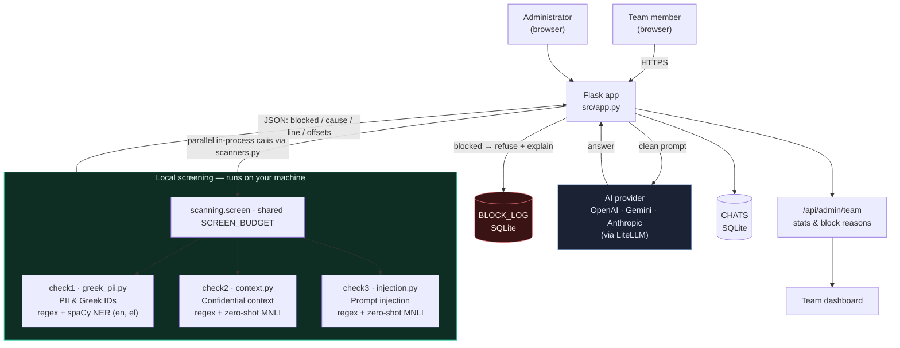

# CyberSyn — AI Security Gateway

**Shadow AI protection & Data Protection** · Netcompany Hackathon Athens 2026 · Challenge 3

> Employees paste code, contracts and client data into public AI tools every day, often without IT knowing.
> For prompts sent through CyberSyn, the member’s policy runs **on the gateway** before forwarding.
> Blocks are explained to the sender; administrator exceptions are recorded without logging the blocked text.

---

## Contents

- [Key features](#key-features)
- [Architecture](#architecture)
- [The three-gate pipeline](#the-three-gate-pipeline)
- [Quick start (Docker)](#quick-start-docker)
- [Local development](#local-development)
- [Configuration](#configuration)
- [Security & privacy design](#security--privacy-design)
- [Testing & evaluation](#testing--evaluation)
- [Project layout](#project-layout)
- [API reference](#api-reference)
- [Limitations & roadmap](#limitations--roadmap)

---

CyberSyn is a self-hosted **AI gateway for teams**. Team members chat with the AI model of their choice
through CyberSyn; administrators define what must never leave. The server applies the member’s enabled local
checks, and a risky prompt is stopped **before** it is sent — with the exact line, offset and reason shown
to the user instead of a generic refusal.

Design principles:

1. **Local first.** Scanning happens on the machine running CyberSyn. Prompts are never shipped to a
   third-party DLP service for inspection — that would just move the leak.
2. **Fail closed.** If a scanner crashes or times out, the request is refused. A broken gate is never an
   open gate.
3. **Explain, don't just block.** Every block names the stage, the category, the line number and the
   offending snippet, so the user learns the rule instead of fighting it.
4. **Humans stay in control.** An administrator can approve a genuine exception; the override is recorded
   and attributed, not silently allowed.
5. **Minimise audit data.** A blocked snippet is shown to its sender. The logs retain the stage,
   reason, actor and time, not the snippet. Ordinary prompt previews are off by default.

## Key features

**Protection**

- Three independent screening stages: personal/Greek identifiers, confidential company context, and
  prompt injection (see [the pipeline](#the-three-gate-pipeline)).
- Greek-aware detection: **AFM** (with checksum validation), **AMKA**, Greek phone numbers, Greek and Latin
  company suffixes, plus person names in both English and Greek via dual spaCy NER models.
- Credential and secret detection: DB connection strings, private keys, IBANs, `sk-`/`AKIA` keys, inline
  `password=`/`token=` assignments.
- Prompt-injection detection that reads code comments too — multi-line comment blocks are merged so an
  attack split across lines is still caught.
- Server-enforced **per-member** checks and a separate **Block proprietary source code** toggle.
  Code alone is allowed by default. Workspace defaults seed new members; they do not rewrite existing policies.

**Governance & visibility**

- Administrator statistics (`/stats`): prompts answered and blocked per member, reasons, trends and a timestamped activity log.
- Block log persisted in SQLite and attributed to a member and a stage.
- Admin-approved override: a blocked prompt can be released by entering the administrator password; the
  exception is attributed in the audit trail.
- Full multi-chat history: create, open, rename and delete chats, restored on login.

**Platform**

- Bring your own model: OpenAI, Google Gemini or Anthropic through LiteLLM, with live model discovery
  from the provider (paste a key, pick a model from the list).
- Bilingual interface — English and Greek, switched at runtime and preserved across pages.
- Runs entirely in Docker with one command; no external database to provision.

## Architecture



**Request lifecycle**

1. The browser posts a prompt to `POST /api/admin/employee/chat`, with its HttpOnly member cookie and CSRF header. API clients may use a body token.
2. The server authorises the caller — the member's own token, and an administrator's token as well
   when the request is an override. Unauthorised calls are refused before any work is done.
3. The server resolves the member's saved settings (enabled checks, encrypted API key, model).
4. `scanning.screen()` runs enabled checks in parallel via `scanners.py`, against one shared deadline
   (45 seconds by default). Loaded models are reused. Missing imports may use a serialized subprocess
   fallback if configured; runtime failures and timeouts fail closed. Blocks are reported in stage order.
5. On a hit: the block is written to `BLOCK_LOG` with stage and reason, and the response carries full
   `block_info` — stage, cause, line, start/end offsets, snippet and the blocking matches.
6. On a clean pass: the prompt goes to the selected provider and the exchange is saved to the chat
   history.

## The three-gate pipeline

| # | Script | Detects | Technique | Blocks when |
|---|---|---|---|---|
| 1 | `src/MLscripts/greek_pii.py` | AFM checksum, AMKA date, Greek ID format/context, IBAN mod-97, phones, emails, modern provider/access keys, companies and names (EN + EL) | Regex with checksum & context scoring, plus spaCy `en_core_web_sm` / `el_core_news_sm` NER | A PII match scores ≥ 0.80 |
| 2 | `src/MLscripts/context.py` | Credentials/banking, legal contracts & NDAs, internal financials, HR/payroll/customer dumps, source code | IBAN mod-97, Luhn, strict confidential indicators; `valhalla/distilbart-mnli-12-1` zero-shot classification (threshold 0.55) on lines the regexes did not already explain | Confidential hit, or source when this member’s `block_code` is enabled |
| 3 | `src/MLscripts/injection.py` | Prompt injection and instruction override, including attacks hidden in code comments | Attack-phrase regexes + zero-shot classification (threshold 0.60); examines adjacent lines, `#`/`//`/`--`, block/HTML comments, strings and docstrings | `PROMPT_INJECTION` detected |

The staged design is deliberate: cheap, precise regexes fire first and the neural classifier only sees
lines the rules could not explain. That keeps latency and false positives down, and the zero-shot model
means a new category is a label change, not a retraining.

## Quick start (Docker)

Requires [Docker](https://docs.docker.com/get-docker/) with Compose v2.

```bash
git clone https://github.com/JohannSSK/CyberSyn.git
cd CyberSyn
docker compose up --build
```

Open **<http://localhost:5000>**.

The first build downloads dependencies and bakes the classification model into the image (a few minutes).
Later starts are fast.

```bash
docker compose up                 # start
docker compose logs -f cybersyn   # follow logs
docker compose down               # stop (keeps data)
docker compose down -v            # stop and delete BOTH volumes (irreversible)
```

**First run**

1. Create the first administrator locally, **before exposing the port**. Later signups need an existing
   administrator or the configured `CYBERSYN_ADMIN_SIGNUP_TOKEN` (the creation page has an optional field).
2. Sign in as administrator, add team members and sign in as the intended member. This revokes the browser’s primary admin session.
3. In **Settings**, select a provider before pasting an ambiguous key, select a model and save the connection with administrator approval.
4. Under **Local safety checks**, set **Block proprietary source code** for this member and choose **Save checks**.
   Leave it off for ordinary code reviews. Both “also save” options affect future members, not existing colleagues. Saving a connection as the default includes its key.

Docker runs **Gunicorn**, one worker with eight threads by default; spaCy and DistilBART are loaded once
per worker. The first build needs network access to the CPU wheel index, PyPI, GitHub and Hugging Face.
`cybersyn-data` holds SQLite at `/app/src/backend`. `cybersyn-secrets` holds the Fernet key at
`/app/secrets/secret.key`. Back up both **separately**. On upgrading a deployment with an existing
`src/backend/secret.key`, stop the old service and install that same key into the new secrets volume
(owner `cybersyn`, mode `0600`) **before starting**; verify existing keys decrypt before removing the old
copy. For the supplied Compose layout, after backing up the old volume:

```bash
docker compose down  # never use -v during an upgrade
docker compose build
docker compose run --rm --no-deps --user root --entrypoint sh cybersyn -ec '
  test -s /app/src/backend/secret.key
  test ! -e /app/secrets/secret.key
  install -o cybersyn -g cybersyn -m 0600 /app/src/backend/secret.key /app/secrets/secret.key'
```

Only use this migration when the old **file** was the active encryption key. If the destination
already exists, compare and restore from backup rather than overwriting it. Generating a replacement
cannot decrypt old keys. If you previously used `CYBERSYN_KEY`, continue supplying that same value;
it takes precedence over any file.

**Build verification.** The image build runs `pip check` and actual inference with the English and
Greek NER models and DistilBART (not just an import). Verify on both native Linux architectures, or
with a Buildx builder supporting amd64 and arm64. The optional **Verify container** Actions workflow
checks both native architectures, including an offline forward pass as the runtime user:

```bash
docker compose config --quiet
docker buildx build --platform linux/amd64,linux/arm64 --output=type=cacheonly .
docker compose up --build -d --wait
```

Run behind an HTTPS reverse proxy in production. Preserve the public Host and forward the scheme
from a **trusted** proxy, so Flask can compare Origin with the public origin. Set
`CYBERSYN_COOKIE_SECURE=1` when terminating TLS upstream. Keep `CYBERSYN_TRUST_PROXY` off unless
clients cannot bypass the proxy or supply the forwarded IP header themselves.

## Local development

Use Python **3.11+** (3.11–3.13 for the pinned dependencies). Linux setup installs PyTorch from the
CPU-only index first; macOS uses the native arm64 PyPI wheel. Prefer `setup.sh` over a direct Linux
`pip install -r requirements.txt`, which otherwise uses PyPI’s default torch build.

```bash
./setup.sh                 # creates .venv, installs dependencies, fetches the model
./run.sh                   # starts the server
./run.sh seed <username>   # creates the first administrator
```

There is no default account. A gateway that ships with a known username and password
is a gateway anyone can sign in to, so `seed` has to be given one. Omit the password
and a random one is generated and printed once.

`run.sh` reads the host, the port and every path from `includes/constants.json`, so
editing that file is enough to move the app. The environment still wins where it has
to — a container cannot bind `0.0.0.0` by editing a tracked file:

```bash
CYBERSYN_HOST=0.0.0.0 ./run.sh
```

Both scripts work on Linux and macOS, under bash, zsh, fish, dash or ksh, and from any
directory, including when symlinked onto your `PATH`. **Windows is not supported:**
the scanners need `torch` and `spaCy`, which do not build reliably there. Use WSL
(`wsl --install`, then run `setup.sh` inside Ubuntu) or `docker compose up --build`.
`setup.sh` detects Windows and says so rather than failing halfway through.

## Testing

Run the tests from the repository root:

```bash
python3 tools/test_constants.py    # includes/constants.json is real, and is actually used
python3 tools/test_auth.py         # authorisation on the member routes
python3 tools/test_screening.py    # the screening stage: bounded, parallel, fail-closed
python3 tools/test_providers.py    # provider discovery and address safety
python3 tools/test_provider_errors.py
python3 tools/test_gateway.py      # real DB/session/concurrency/policy boundaries
python3 tools/test_scanner_rules.py # deterministic scanner rules with model stand-ins
python3 tools/test_models.py       # model discovery uses the stored key
node tools/test_frontend.js        # browser behaviour (needs: npm install jsdom)
node tools/test_account_pages.js
```

`smoke.py` needs a running **disposable test workspace**: it creates fixture accounts and removes a fixture member. Do not run it against production.

```bash
./run.sh &  python3 tools/smoke.py
```

It follows `includes/constants.json` too, so it finds the server wherever that file
says it is; `python3 tools/smoke.py http://host:port` overrides it.

### Debugging a blocked prompt

`tools/test_mls.py` puts a prompt through one scanner and prints the verdict it
returns, so "why did that get blocked?" does not need `print()` statements:

```bash
python3 tools/test_mls.py                        # pick a scanner, then type a prompt
python3 tools/test_mls.py context "sk-abc..."    # straight to the JSON
python3 tools/test_mls.py all -                   # all three, prompt on stdin
python3 tools/test_mls.py --list                  # which scanners load here
```

It loads the scanners through `src/scanners.py`, the same way a request does, so
the JSON is what the app would act on. Finish a pasted prompt with a line
containing only `.`, or pipe it in with `-` when the prompt has such a line.

## Configuration

All settings are optional; defaults suit the Docker flow.

| Variable | Default | Purpose |
|---|---|---|
| `CYBERSYN_HOST` | `127.0.0.1` (`0.0.0.0` in Docker) | Bind address |
| `CYBERSYN_PORT` | `5000` | Bind port |
| `CYBERSYN_DEBUG` | `0` | Set `1` for the Werkzeug debugger/reloader (development only) |
| `CYBERSYN_KEY` / `CYBERSYN_KEY_FILE` | Generated file | Fernet key override or key file; native default `src/backend/secret.key`, separate secrets volume in Docker |
| `CYBERSYN_ADMIN_SIGNUP_TOKEN` / `CYBERSYN_ALLOW_OPEN_SIGNUP` | Unset / `0` | Gate additional administrators; enable open signup only deliberately |
| `CYBERSYN_ALLOW_PRIVATE_BASE` | `1` | Allows self-hosted/LAN models. Set `0` to refuse non-public destinations; metadata is always denied |
| `CYBERSYN_COOKIE_SECURE` | `0` | Force Secure cookies behind HTTPS termination (always set on HTTPS requests) |
| `CYBERSYN_RATE_LIMIT` / `CYBERSYN_TRUST_PROXY` | `1` / `0` | Failed credential attempts are limited per IP and IP/username; trust forwarded IPs only behind a trusted proxy that replaces the header |
| `CYBERSYN_MAX_BODY_BYTES` / `CYBERSYN_MAX_PROMPT_CHARS` | `262144` / `16000` | Request body and prompt/edit limits |
| `CYBERSYN_LOG_PROMPT_PREVIEW` | `0` | Opt in to 80-character activity previews for ordinary prompts, edits and regenerations; never for blocked or overridden sends |
| `CYBERSYN_SCREEN_BUDGET` / `CYBERSYN_AI_TIMEOUT` | `45` / `60` seconds | Shared screening deadline and outbound model timeout |
| `CYBERSYN_WARM_MODELS` / `CYBERSYN_SCANNER_FALLBACK` | `1` / native `1`, Docker `0` | Background model loading and optional import-failure subprocess fallback |
| `CYBERSYN_THREADS` / `CYBERSYN_DB_FILE` | `8` / path registry | Gunicorn threads and optional SQLite location |

Non-secret defaults (host, port, database and script paths, route names) live in
`includes/constants.json`.

## Security & privacy design

| Concern | How CyberSyn handles it |
|---|---|
| Secrets | Fernet encrypts provider keys; the `0600` key is separate from the DB volume. Settings return only an empty key and a mask. Discovery validates and pins HTTP(S) connections, strips credentials on cross-origin redirects and never broadcasts an unknown key. |
| Login | Salted password hashes (legacy passwords upgrade on successful login), uniform failure messages and bounded credential attempts. No password trimming. |
| Browser sessions | HttpOnly, SameSite=Lax cookies; same-origin custom request header and Origin checks. Only hashed session tokens are stored server-side. Password changes revoke old sessions. |
| Approvals | Single-use 5-minute grants for writes/overrides; read-only page grants expire in 15 minutes and “Lock now” revokes them. Neither supplies a reusable admin login in the member’s browser. |
| Member isolation | IDs are not credentials. The server enforces saved policy/model; only the member's live session can read chats. Offboarding removes sessions, settings and chats together; historical audit/statistics rows remain. |
| Audit | Stage, category, time, actor and safe metadata by default. Blocked/override events never store the prompt or snippet. An explicitly enabled ordinary prompt preview is visible to workspace administrators. |
| Fail-closed | An unavailable, failed or late scanner prevents forwarding. A deliberate admin override is attributed and logged. |
| Web and container | Self-hosted fonts, same-origin CSP, no framing, no referrer, nosniff. Non-root Gunicorn worker, CPU wheels, baked classification weights; no CDN needed at runtime. |

> **Note on the repository:** an encryption key was previously committed in `src/backend/secret.key`. It is
> now untracked and git-ignored, and the app generates a fresh per-deployment key. Anyone who cloned the
> repository before this change should treat that key as public and rotate any API keys stored with it
> (the file remains in git history by design — Git keeps history).

## Testing & evaluation

`tools/smoke.py` exercises account, settings, history and statistics routes over HTTP. With no provider
key configured it verifies the no-key refusal; it does not substitute for real model inference.

### Authorisation tests

```bash
python3 tools/test_auth.py
```

No network or models are needed (scanners and the AI call are stubbed). The tests cover the
token primitives — issue, expiry, revocation, rejection of forged tokens — and then hold the HTTP
boundary to its contract: every member route refuses an unauthenticated caller with `401`, a member
cannot act as another member, an override is refused without a real administrator session, an
administrator's token manages policy but cannot open a member's chats, and adding or removing a team
member needs that workspace's administrator session — never a pair of guessable integers.

These exist because the gap they close was invisible: the routes looked fine and returned sensible
errors, they simply never checked who was calling. A test is what stops that from returning.

Detection quality is measured with the labelled harness in `tools/`:

```bash
python tools/evaluate.py --in-process  # all checks; reuse the loaded models
python tools/evaluate.py check1     # one check
```

It runs every scanner over a labelled corpus of benign prompts and true positives (Greek AFM/AMKA,
credentials, contracts, injection payloads), then reports per-check precision, recall, F1 and latency.
Confusion matrices make the false-positive/false-negative trade-off explicit, which is what makes a
threshold defensible rather than guessed. Run it after `setup.sh` on a machine that has downloaded the
models.

## Project layout

```
.
├── Dockerfile               # multi-stage: deps + baked model, then a slim non-root runtime
├── docker-compose.yml       # one-command start, separate data and secrets volumes
├── includes/constants.json  # host, port, paths, route names
├── requirements.txt
├── setup.sh                 # local dev environment
├── assets/icons/            # 27 PNG icons, rendered by tools/build_icons.py
├── src/
│   ├── app.py               # create_app(): wiring only, no route bodies
│   ├── routes/              # one blueprint per area
│   │   ├── pages.py         # page routes
│   │   ├── admin_api.py     # admin auth, members, accounts, overrides
│   │   ├── member_api.py    # settings and models for a signed-in member
│   │   ├── chat_api.py      # the screened chat call
│   │   ├── chat_history.py  # list/open/rename/delete/search/edit
│   │   └── assets.py        # serves assets/ at /assets/<path>
│   ├── MLscripts/
│   │   ├── greek_pii.py     # check 1 — PII & Greek identifiers
│   │   ├── context.py       # check 2 — confidential company context
│   │   ├── injection.py     # check 3 — prompt injection
│   │   └── model_cache.py   # loads each model once, then scans in-process
│   ├── scanners.py          # in-process runner (subprocess fallback)
│   ├── scanning.py          # parallel checks under one deadline
│   ├── admin_session.py     # administrator token sessions (hashed, expiring)
│   ├── members.py           # authorisation for member routes
│   ├── passwords.py         # hashing and verification
│   ├── secret_store.py      # Fernet encryption of API keys
│   ├── block_log.py         # block audit trail + activity log
│   ├── chat_store.py        # chats and message history
│   ├── team_stats.py        # per-member statistics, trends, timeline
│   ├── models_route.py      # live model discovery per provider
│   ├── ai_client.py         # provider call, keyed by member
│   ├── config.py db.py errors.py web.py
│   ├── templates/           # base.html + one template per page
│   │   └── partials/sidebar.html   # the shared navigation, defined once
│   └── static/
│       ├── css/             # base, components, auth, workspace, page, stats
│       └── js/
│           ├── core/        # dom, icons, api, loading, markdown, shell
│           └── auth.js workspace.js profile.js settings.js stats.js team.js
└── tools/
    ├── evaluate.py          # precision / recall / F1 harness
    ├── smoke.py             # drives the app over HTTP
    ├── test_auth.py         # authorisation unit tests
    ├── build_icons.py       # renders icons.js -> assets/icons/*.png
    └── icons/               # Pillow-only SVG rasteriser used by the above
```

Layout: `app.py` composes, `routes/` answer, `src/*.py` hold
the domain logic, and the browser gets one CSS file and one JS file per concern
rather than a single bundle.

## API reference

`API_Examples.md` documents every endpoint with request/response examples, including success, error,
Greek-text, multi-line-code and blocked-prompt cases.

| Endpoint | Purpose |
|---|---|
| `POST /api/admin`, `/api/admin/login`, `/api/admin/approve`, `/api/admin/password` | Account, login, scoped approval and password rotation |
| `POST /api/admin/session`, `/api/admin/logout` | Session validation, logout or page lock |
| `POST /api/admin/employee`, `…/employee/login`, `…/employee/logout`, `…/employee/account` | Member lifecycle |
| `POST /api/admin/employee/settings` | Per-member and workspace-default policy and connection |
| `POST /api/admin/employee/providers`, `…/employee/models` | Provider registry and scoped discovery |
| `POST /api/admin/employee/chat`, `…/chat/regenerate` | Screened single-prompt completion / re-screened regeneration |
| `POST /api/admin/employee/chats`, `…/chats/open`, `…/chats/rename`, `…/chats/delete`, `…/chats/search` | Member’s own chat history |
| `POST /api/admin/employee/chats/message/edit`, `…/message/delete` | Modify a stored exchange |
| `POST /api/admin/team`, `/api/admin/team/list`, `/api/admin/employee/override/check` | Statistics, roster and page-access verification |

See [API examples](API_Examples.md) for request bodies, response shapes and permission rules.

## Limitations & roadmap

- **SQLite** keeps the prototype to one container and zero configuration; PostgreSQL (an official image)
  is the migration path for multi-instance deployments.
- **Gateway coverage** today is the CyberSyn chat surface. Capturing traffic from arbitrary AI sites needs
  a browser extension or proxy (LiteLLM/mitmproxy) in front of those calls — the natural next step, and
  the reason the scanners are standalone stdin→JSON processes that any transport can call.
- **Stored chats are not encrypted.** The DB contains answered exchanges, including approved overrides.
  Protect backups and restrict host access. Upgrading removes old prompt details from the live activity
  timeline; it does not erase old backups. Deletion retains audit statistics.
- **Detection is English/Greek tuned**; more languages mean more patterns and NER models.
- **Redaction instead of blocking** — "warn and forward a sanitised prompt" — is the most requested next
  policy action, and the per-match offsets needed for it are already returned by every scanner.
- **Accuracy numbers** come from the harness in `tools/`; regenerating them on the judging machine keeps
  the reported thresholds honest.

---

Built for the Netcompany Hackathon Athens 2026, Challenge 3 — *Shadow AI protection & Data Protection*.
