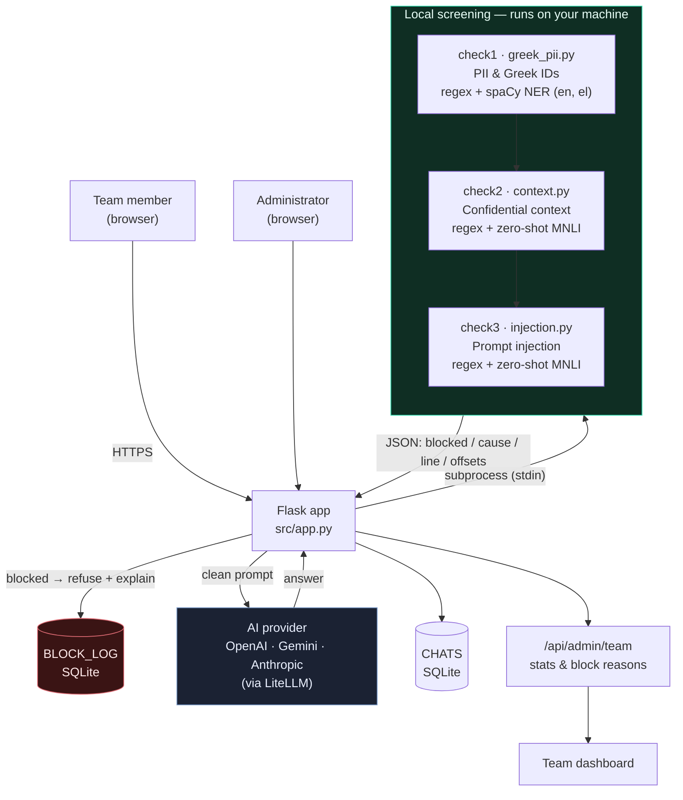

# CyberSyn — AI Security Gateway

**Shadow AI protection & Data Protection** · Netcompany Hackathon Athens 2026 · Challenge 3

> Employees paste code, contracts and client data into public AI tools every day, often without IT knowing.
> CyberSyn is the gate those prompts pass through: every message is screened **on your own machine**,
> before it ever reaches an AI provider — and every decision is explained, logged and auditable.

---

## Contents

- [Key features](#key-features)
- [Architecture](#architecture)
- [The three-gate pipeline](#the-three-gate-pipeline)
- [Quick start (Docker)](#quick-start-docker)
- [Local development](#local-development)
- [Configuration](#configuration)
- [Security & privacy design](#security--privacy-design)
- [Testing & evaluation](#testing--evaluation)
- [Project layout](#project-layout)
- [API reference](#api-reference)
- [Limitations & roadmap](#limitations--roadmap)

---

CyberSyn is a self-hosted **AI gateway for teams**. Team members chat with the AI model of their choice
through CyberSyn; administrators define what must never leave. Every prompt is screened by three local
checks, and a risky prompt is stopped **before** it is sent — with the exact line, offset and reason shown
to the user instead of a generic refusal.

Design principles:

1. **Local first.** Scanning happens on the machine running CyberSyn. Prompts are never shipped to a
   third-party DLP service for inspection — that would just move the leak.
2. **Fail closed.** If a scanner crashes or times out, the request is refused. A broken gate is never an
   open gate.
3. **Explain, don't just block.** Every block names the stage, the category, the line number and the
   offending snippet, so the user learns the rule instead of fighting it.
4. **Humans stay in control.** An administrator can approve a genuine exception; the override is recorded
   and attributed, not silently allowed.
5. **Watch the watcher.** CyberSyn stores the minimum it needs, encrypts secrets at rest, and treats the
   audit trail as sensitive data too.

## Key features

**Protection**

- Three independent screening stages: personal/Greek identifiers, confidential company context, and
  prompt injection (see [the pipeline](#the-three-gate-pipeline)).
- Greek-aware detection: **AFM** (with checksum validation), **AMKA**, Greek phone numbers, Greek and Latin
  company suffixes, plus person names in both English and Greek via dual spaCy NER models.
- Credential and secret detection: DB connection strings, private keys, IBANs, `sk-`/`AKIA` keys, inline
  `password=`/`token=` assignments.
- Prompt-injection detection that reads code comments too — multi-line comment blocks are merged so an
  attack split across lines is still caught.
- Per-team toggles per check, so a team can disable a stage that does not apply to its work.
- **Photo scan** (`/photo-scan`): upload a picture and CyberSyn finds the personal data in it —
  faces (MTCNN), ΑΦΜ, ΑΜΚΑ, phones, IBANs (ISO-13616 checksum-verified), payment cards (Luhn),
  ID numbers, plates and labelled document fields («ΕΠΩΝΥΜΟ», «ΟΝΟΜΑ», «ΔΙΕΥΘΥΝΣΙΣ»…) — then hands
  back a redacted copy. Photos are screened in memory and never written to disk.

**Governance & visibility**

- Administrator dashboard (`/team`): prompts sent, answered and blocked per member, block rate, and a
  ranking of block reasons and stages — the "which teams sent what this week" question, answered.
- Block log persisted in SQLite and attributed to a member and a stage.
- Admin-approved override: a blocked prompt can be released by entering the administrator password; the
  message is then flagged as bypassed in the transcript.
- Full multi-chat history: create, open, rename and delete chats, restored on login.

**Platform**

- Bring your own model: OpenAI, Google Gemini or Anthropic through LiteLLM, with live model discovery
  from the provider (paste a key, pick a model from the list).
- Bilingual interface — English and Greek, switched at runtime and preserved across pages.
- Runs entirely in Docker with one command; no external database to provision.

## Architecture



**Request lifecycle**

1. The browser posts a prompt to `POST /api/admin/employee/chat`, with the session token issued at sign-in.
2. The server authorises the caller — the member's own token, and an administrator's token as well
   when the request is an override. Unauthorised calls are refused before any work is done.
3. The server resolves the member's saved settings (enabled checks, encrypted API key, model).
4. Enabled scanners run **in order** as separate processes, each reading the prompt on stdin and
   printing a JSON verdict. A scanner that fails, times out (60 s) or prints no verdict **blocks** the
   request (fail closed).
5. On a hit: the block is written to `BLOCK_LOG` with stage and reason, and the response carries full
   `block_info` — stage, cause, line, start/end offsets, snippet and every match.
6. On a clean pass: the prompt goes to the selected provider and the exchange is saved to the chat
   history.

## The three-gate pipeline

| # | Script | Detects | Technique | Blocks when |
|---|---|---|---|---|
| 1 | `src/MLscripts/greek_pii.py` | AFM, AMKA, Greek phones, emails, provider API keys, company names, person names (EN + EL) | Regex with checksum & context scoring, plus spaCy `en_core_web_sm` / `el_core_news_sm` NER | A PII match scores ≥ 0.80 |
| 2 | `src/MLscripts/context.py` | Credentials/banking, legal contracts & NDAs, internal financials, HR/payroll/customer dumps, source code | Curated bilingual regexes first; `valhalla/distilbart-mnli-12-1` zero-shot classification (threshold 0.55) on lines the regexes did not already explain | Top label is a blocked category |
| 3 | `src/MLscripts/injection.py` | Prompt injection and instruction override, including attacks hidden in code comments | Attack-phrase regexes + zero-shot classification (threshold 0.60); consecutive `#` comment lines are merged before classification | `PROMPT_INJECTION` detected |

The staged design is deliberate: cheap, precise regexes fire first and the neural classifier only sees
lines the rules could not explain. That keeps latency and false positives down, and the zero-shot model
means a new category is a label change, not a retraining.

## Quick start (Docker)

Requires [Docker](https://docs.docker.com/get-docker/) with Compose v2.

```bash
git clone https://github.com/JohannSSK/CyberSyn.git
cd CyberSyn
docker compose up --build
```

Open **<http://localhost:5000>**.

The first build downloads dependencies and bakes the classification model into the image (a few minutes).
Later starts are fast.

```bash
docker compose up                 # start
docker compose logs -f cybersyn   # follow logs
docker compose down               # stop (keeps data)
docker compose down -v            # stop and delete the data volume
```

**First run**

1. On the sign-in page choose **Create administrator account**.
2. Sign in as the administrator, then add your team members.
3. Open **Settings**, paste an AI provider API key, choose the enabled checks, and confirm with your
   administrator password.
4. Sign in as a team member and start chatting.

Your data (accounts, chats, block log, generated encryption key) lives in the `cybersyn-data` volume at
`/app/src/backend`, so it survives container rebuilds.

## Local development

```bash
./setup.sh                 # creates .venv, installs dependencies, fetches the model
./run.sh                   # starts the server
./run.sh seed <username>   # creates the first administrator
```

There is no default account. A gateway that ships with a known username and password
is a gateway anyone can sign in to, so `seed` has to be given one. Omit the password
and a random one is generated and printed once.

`run.sh` reads the host, the port and every path from `includes/constants.json`, so
editing that file is enough to move the app. The environment still wins where it has
to — a container cannot bind `0.0.0.0` by editing a tracked file:

```bash
CYBERSYN_HOST=0.0.0.0 ./run.sh
```

Both scripts work on Linux and macOS, under bash, zsh, fish, dash or ksh, and from any
directory, including when symlinked onto your `PATH`. **Windows is not supported:**
the scanners need `torch` and `spaCy`, which do not build reliably there. Use WSL
(`wsl --install`, then run `setup.sh` inside Ubuntu) or `docker compose up --build`.
`setup.sh` detects Windows and says so rather than failing halfway through.

## Testing

Everything in `tools/` runs from the repository root and needs no arguments:

```bash
python3 tools/test_constants.py    # includes/constants.json is real, and is actually used
python3 tools/test_auth.py         # authorisation on the member routes
python3 tools/test_screening.py    # the screening stage: bounded, parallel, fail-closed
python3 tools/test_providers.py    # provider discovery and address safety
python3 tools/test_provider_errors.py
python3 tools/test_models.py       # model discovery uses the stored key
node tools/test_frontend.js        # browser behaviour (needs: npm install jsdom)
node tools/test_account_pages.js
```

`smoke.py` is the only one that needs a running server — start one first, then:

```bash
./run.sh &  python3 tools/smoke.py
```

It follows `includes/constants.json` too, so it finds the server wherever that file
says it is; `python3 tools/smoke.py http://host:port` overrides it.

### Debugging a blocked prompt

`tools/test_mls.py` puts a prompt through one scanner and prints the verdict it
returns, so "why did that get blocked?" does not need `print()` statements:

```bash
python3 tools/test_mls.py                        # pick a scanner, then type a prompt
python3 tools/test_mls.py context "sk-abc..."    # straight to the JSON
python3 tools/test_mls.py all -                   # all three, prompt on stdin
python3 tools/test_mls.py --list                  # which scanners load here
```

It loads the scanners through `src/scanners.py`, the same way a request does, so
the JSON is what the app would act on. Finish a pasted prompt with a line
containing only `.`, or pipe it in with `-` when the prompt has such a line.

## Configuration

All settings are optional; defaults suit the Docker flow.

| Variable | Default | Purpose |
|---|---|---|
| `CYBERSYN_HOST` | `127.0.0.1` (`0.0.0.0` in Docker) | Bind address |
| `CYBERSYN_PORT` | `5000` | Bind port |
| `CYBERSYN_DEBUG` | `0` | Set `1` for the Werkzeug debugger/reloader (development only) |
| `CYBERSYN_KEY` | *(unset)* | Fernet key for encrypting stored API keys. Unset → a key is generated and stored in the data volume |

Non-secret defaults (host, port, database and script paths, route names) live in
`includes/constants.json`.

## Security & privacy design

| Concern | How CyberSyn handles it |
|---|---|
| Keys at rest | Provider API keys are encrypted with Fernet before touching SQLite. The key lives outside the database (env var or a `0600` file in the data volume) and is never returned by the API — only a mask such as `****7890` |
| Key in transit to the browser | `settings_payload()` always returns an empty `API_KEY` field |
| Passwords | `werkzeug` salted hashes; legacy plaintext rows are transparently upgraded to hashes on next successful login |
| Sessions | Random tokens for both administrators and team members; only the SHA-256 hash is stored, with a 7-day expiry checked on every use |
| Authenticated routes | Every route that touches a member's prompts, history or settings requires that member's session token. A pair of IDs is never enough, and a member cannot act as another member |
| Chat privacy | An administrator's token manages policy but never reads a member's chats: history routes accept the member's own session only |
| Fail-closed | Scanner crash, timeout, or unparseable output → the request is refused and never forwarded |
| Overrides | An override needs a valid **administrator session token**, verified server-side (not only in the browser), and is written to the audit log as `override / administrator approved` |
| Data minimisation | Only what the audit trail needs is stored: stage, reason, member and timestamp — **not** the prompt text of an approved message |
| Local inspection | Prompts are analysed in-process on the host; they are never sent to a third-party classifier for inspection |
| Container hardening | Multi-stage build, non-root user, no compiler or pip cache in the final image, baked model so scanning works offline |
| Transparency | The in-app **Help & info** page states, in English and Greek, exactly what is stored and where |

> **Note on the repository:** an encryption key was previously committed in `src/backend/secret.key`. It is
> now untracked and git-ignored, and the app generates a fresh per-deployment key. Anyone who cloned the
> repository before this change should treat that key as public and rotate any API keys stored with it
> (the file remains in git history by design — Git keeps history).

## Testing & evaluation

Smoke-tested flows (administrator login, member add/login, settings with key masking, team stats, and
fail-closed refusal when a scanner is unavailable) are exercised against a running instance.

### Authorisation tests

```bash
python3 tools/test_auth.py
```

21 tests, no network and no models needed (the scanners and the AI call are stubbed). They cover the
token primitives — issue, expiry, revocation, rejection of forged tokens — and then hold the HTTP
boundary to its contract: every member route refuses an unauthenticated caller with `401`, a member
cannot act as another member, an override is refused without a real administrator session, and an
administrator's token manages policy but cannot read a member's chats.

These exist because the gap they close was invisible: the routes looked fine and returned sensible
errors, they simply never checked who was calling. A test is what stops that from returning.

Detection quality is measured with the labelled harness in `tools/`:

```bash
python tools/evaluate.py            # all checks
python tools/evaluate.py check1     # one check
```

It runs every scanner over a labelled corpus of benign prompts and true positives (Greek AFM/AMKA,
credentials, contracts, injection payloads), then reports per-check precision, recall, F1 and latency.
Confusion matrices make the false-positive/false-negative trade-off explicit, which is what makes a
threshold defensible rather than guessed. Run it after `setup.sh` on a machine that has downloaded the
models.

## Project layout

```
.
├── Dockerfile               # multi-stage: deps + baked model, then a slim non-root runtime
├── docker-compose.yml       # one-command start, persistent data volume
├── includes/constants.json  # host, port, paths, route names
├── requirements.txt
├── setup.sh                 # local dev environment
├── assets/icons/            # 27 PNG icons, rendered by tools/build_icons.py
├── src/
│   ├── app.py               # create_app(): wiring only, no route bodies
│   ├── routes/              # one blueprint per area
│   │   ├── pages.py         # the seven page routes
│   │   ├── admin_api.py     # admin auth, members, accounts, overrides
│   │   ├── member_api.py    # settings and models for a signed-in member
│   │   ├── chat_api.py      # the screened chat call
│   │   ├── chat_history.py  # list/open/rename/delete/search/edit
│   │   └── assets.py        # serves assets/ at /assets/<path>
│   ├── MLscripts/
│   │   ├── greek_pii.py     # check 1 — PII & Greek identifiers
│   │   ├── context.py       # check 2 — confidential company context
│   │   ├── injection.py     # check 3 — prompt injection
│   │   └── model_cache.py   # loads each model once, then scans in-process
│   ├── scanners.py          # in-process runner (subprocess fallback)
│   ├── scanning.py          # run_check(): the three checks, in order
│   ├── admin_session.py     # administrator token sessions (hashed, expiring)
│   ├── members.py           # authorisation for member routes
│   ├── passwords.py         # hashing and verification
│   ├── secret_store.py      # Fernet encryption of API keys
│   ├── block_log.py         # block audit trail + activity log
│   ├── chat_store.py        # chats and message history
│   ├── team_stats.py        # per-member statistics, trends, timeline
│   ├── models_route.py      # live model discovery per provider
│   ├── ai_client.py         # provider call, keyed by member
│   ├── config.py db.py errors.py web.py
│   ├── templates/           # base.html + one template per page
│   │   └── partials/sidebar.html   # the shared navigation, defined once
│   └── static/
│       ├── css/             # base, components, auth, workspace, page, stats
│       └── js/
│           ├── core/        # dom, icons, api, loading, markdown, shell
│           └── auth.js workspace.js profile.js settings.js stats.js team.js
└── tools/
    ├── evaluate.py          # precision / recall / F1 harness
    ├── smoke.py             # drives the whole app over HTTP (22 checks)
    ├── test_auth.py         # authorisation unit tests
    ├── build_icons.py       # renders icons.js -> assets/icons/*.png
    └── icons/               # Pillow-only SVG rasteriser used by the above
```

Every module has one job: `app.py` composes, `routes/` answer, `src/*.py` hold
the domain logic, and the browser gets one CSS file and one JS file per concern
rather than a single bundle.

## API reference

`API_Examples.md` documents every endpoint with request/response examples, including success, error,
Greek-text, multi-line-code and blocked-prompt cases.

| Endpoint | Purpose |
|---|---|
| `POST /api/admin/login`, `/api/admin` | Administrator authentication and management |
| `POST /api/admin/employee`, `.../employee/login`, `.../employee/account` | Team member lifecycle |
| `POST /api/admin/employee/settings` | Per-member policy: enabled checks, model, API key |
| `POST /api/admin/employee/chat` | The screened chat call (`bypass` plus `admin_token` for admin-approved sends) |
| `POST /api/admin/employee/chats[/open\|/rename\|/delete]` | Chat history (member's own session only) |
| `POST /api/admin/employee/models` | Model discovery for the pasted key's provider |

Every route below `/api/admin/employee/` takes the `session_token` issued at team-member sign-in;
`/api/admin/employee/settings` also accepts the administrator's token so an administrator can set a
member's policy.
| `POST /api/admin/team` | Team statistics |
| `POST /api/admin/session`, `/api/admin/logout` | Session validation and teardown |

## Limitations & roadmap

- **SQLite** keeps the prototype to one container and zero configuration; PostgreSQL (an official image)
  is the migration path for multi-instance deployments.
- **Gateway coverage** today is the CyberSyn chat surface. Capturing traffic from arbitrary AI sites needs
  a browser extension or proxy (LiteLLM/mitmproxy) in front of those calls — the natural next step, and
  the reason the scanners are standalone stdin→JSON processes that any transport can call.
- **Detection is English/Greek tuned**; more languages mean more patterns and NER models.
- **Redaction instead of blocking** — "warn and forward a sanitised prompt" — is the most requested next
  policy action, and the per-match offsets needed for it are already returned by every scanner.
- **Accuracy numbers** come from the harness in `tools/`; regenerating them on the judging machine keeps
  the reported thresholds honest.

---

Built for the Netcompany Hackathon Athens 2026, Challenge 3 — *Shadow AI protection & Data Protection*.
