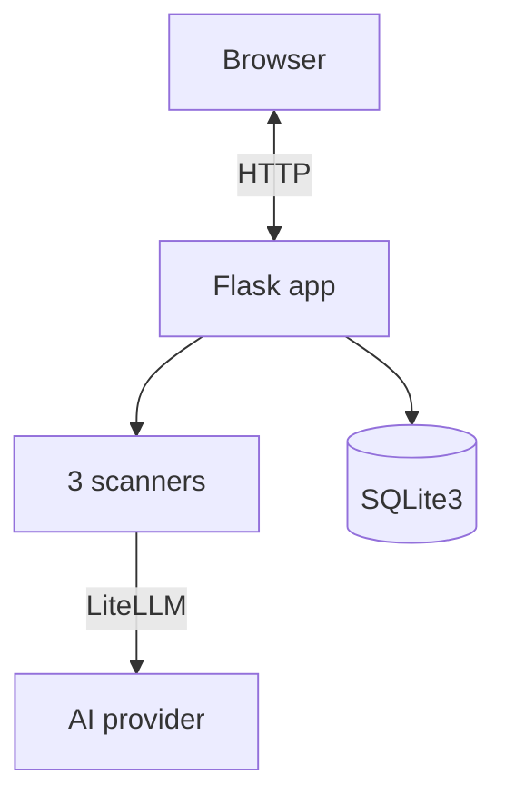

# CyberSyn — AI Security Gateway

CyberSyn is a self-hosted AI gateway that screens every prompt using local Machine Learning models ( before it reaches an AI model, enforcing per-member allow, warn, redact or block policies while giving administrators visibility into shadow AI usage.

### Why MLs? 
Traditional regex is too "dumb" to understand context, and cloud-based AI security is a privacy paradox. CyberSyn uses local ML to read and redact sensitive data with human-like context, ensuring that Shadow AI is mitigated without a single byte of corporate data ever leaving the company's infrastructure. It's not perfect. It can never be. But it's the closest we can get without local LLMs that would skyrocket hardware requirements.

## The three scanners

Every prompt is checked locally by three independent scanners before it is sent.

### 1. Personal & Greek identifiers

- **Detects:** AFM (checksum-validated), AMKA, passports and ID cards, phone numbers, emails, IBANs, company names and person names.
- **How:** regex rules plus English and Greek language models.

### 2. Confidential company context

- **Detects:** credentials and secrets, contracts and NDAs, internal financials, HR/payroll/customer data and source code.
- **How:** regex rules plus a zero-shot classifier.

### 3. Prompt injection

- **Detects:** instruction-override attacks, including obfuscated payloads and instructions hidden in code comments.
- **How:** attack patterns plus a zero-shot classifier.

## Running CyberSyn

CyberSyn is a Flask web app. It serves the UI, stores data in SQLite and talks to the AI provider you configure. Everything runs locally — no external database or service is required.

### Docker (recommended)

```bash
git clone https://github.com/JohannSSK/CyberSyn.git
cd CyberSyn
docker compose up --build
```

Open http://localhost:5000.

OR

```bash
git clone https://github.com/JohannSSK/CyberSyn.git
cd CyberSyn
./setup.sh
./run.sh # or cybersyn -p 5000 to launch
```

## Backend

- **Web app:** Flask serves the UI and the JSON API from one process.
- **Server:** Docker runs Gunicorn with one worker and eight threads; the worker keeps the scanner models in memory and the threads share the scanner locks.
- **Storage:** SQLite holds chats, policy, block logs and discovery data — no external database to provision.
- **Secrets:** provider keys are encrypted with a Fernet key kept in a separate file (native) or volume (Docker).
- **Models:** the scanner models load once in the background at start-up and stay warm.

## AI providers

CyberSyn does not provide a model — you bring your own. In **Settings**, paste an API key, pick a model from the list CyberSyn fetches from the provider, and save. Supported providers:

- OpenAI, Anthropic, Google Gemini, OpenRouter, Groq, Mistral AI, Together AI, DeepSeek, xAI (Grok), Cohere
- Ollama, for models running on your own machine
- Any OpenAI-compatible endpoint, through a custom base URL

CyberSyn detects the provider from the key format, or you can choose it yourself. Saved keys are encrypted at rest and never shown again;



## How a team uses CyberSyn

1. **Administrator sets up** — creates the account, adds members, sets the workspace policy.
2. **Members chat** — every prompt passes the local scanners and the member's policy.
3. **Administrator oversees** — statistics, block reasons, Shadow AI and exceptions.

### Who is who

| Role | What they can do |
|---|---|
| **Administrator** | Add/remove members · set workspace defaults and per-member policy · approve keys, destinations and blocked releases · view statistics and reports · manage Shadow AI |
| **Team member** | Chat through the gateway · see findings and reasons · set their own model and policy · manage their chats and account |

### Workspaces

Each administrator owns a workspace. Members belong to one workspace and sign in with their username, password and the workspace name (admin name). Everything is kept separate per workspace.

## Features

## Policy actions

Every rule (greek personal information, general sensitive company info and prompt injection) can be set to one of four actions. When a prompt matches, they are applied in this order: **block → warn → redact → allow**.

| Action | What happens |
|---|---|
| **Allow** | The rule is skipped; the other rules and the destination policy still apply. |
| **Warn** | Nothing is sent. The member sees what matched and can edit the prompt or confirm it; confirming runs the checks again. |
| **Redact & send** | The matched text is replaced with a token such as `[EMAIL_1]` and the sanitized prompt is sent. Only the sanitized text is stored. |
| **Block** | The prompt stays on the member's machine. An administrator can release it with an approval, and the exception is recorded. |

- Repeated values share the same token, and overlapping matches are masked together.
- Prompt injection cannot be set to redact — only allow, warn or block.
- Administrators set the workspace defaults; each member can have their own overrides (with admin approval and credentials).

## Shadow AI discovery

### Tool inventory

CyberSyn ships with a catalogue of common AI tools — assistants, coding tools, search and model hubs — each with a vendor, risk score, hosting, training policy and a short GDPR note. Scores are conservative assessments, not certifications. Administrators can register additional tools by domain.

### Statuses

- **Approved** and **restricted** can be reached through the gateway; restricted direct access is flagged in discovery.
- **Unapproved** blocks gateway sends to the tool unless an administrator approves an exception. {This AI tool is unapproved, message was not sent}

### Finding shadow AI

Import CSV, proxy (Squid) or DNS logs. The parser works offline and keeps only the destination host and structured metadata — team, actor, method, bytes and a data category such as client data, source code or credentials. It never stores message contents. A synthetic **sample week** is available for a demo.

### Reports

Filter by 7 days, 30 days or all time, by status, team or data category, then export the result as CSV or JSON. The ranked team view answers "which teams sent client data to unapproved AI?".

## Statistics and audit

Administrators get a per-member and workspace view of what the gateway did.

- **Per member** — messages sent, blocked and overridden, block rate, which checks are on, the model in use, and the top block reasons and stages.
- **Trends** — blocks and overrides per day over the last 30 days.
- **Activity log** — a timestamped timeline of sign-ins, sent messages, warnings, redactions, policy changes, chat actions and approved overrides.
- **Exports** — download the statistics as CSV or JSON.

Audit is metadata-only: entries record the stage, reason, actor and time, never the prompt or matched text. Block and override decisions live in an append-only log the app never prunes; deleting a chat does not remove them.

## OpenAI-compatible proxy

Any OpenAI-compatible client can use CyberSyn as its base URL. Point the client at `http://<cybersyn>/v1`, authenticate with the member's seat token, and the request is screened under that member's policy, redacted and audited; the reply comes back in the normal OpenAI format.

```bash
curl http://localhost:5000/v1/chat/completions \
  -H "Authorization: Bearer <seat-token>" \
  -H "Content-Type: application/json" \
  -d '{"model":"default","messages":[{"role":"user","content":"Hello"}]}'
```

## Security and privacy

| Area | How CyberSyn handles it |
|---|---|
| **Secrets** | Provider keys are encrypted with Fernet; the key is stored separately from the database. Settings show only a mask. |
| **Passwords** | Salted hashes; uniform error messages; failed attempts are rate-limited. |
| **Sessions** | HttpOnly, SameSite cookies; only hashed tokens are stored; changing a password revokes sessions. |
| **Fail-closed** | If a scanner fails or times out, the prompt is refused, not sent. |
| **Audit** | Metadata only — stage, reason, actor and time. Blocked, warned, redacted and overridden prompts are never stored. |
| **Isolation** | Members can only reach their own chats and settings. |

## Bilingual interface

The interface is available in **English and Greek**. A language toggle in the header switches the whole UI at runtime — no reload or restart — and the choice is remembered on the device. Dates, numbers and percentages follow the selected locale.

## Additional features

- Most blocks are bypassable with admin credentials.
- Image parser, no face recognition. Simple.
- Ai context (in messages) can be changed by admin for each team member individually. Max is 10 messages.
- Modern responsive and minimalistic UI that's easy to use for employees, and powerful when mastered by admins.
- Multiple chats per Team-member.
- Search in chat for keywords.

This project was made for NETCOMPANY ATHENS HACKATHON 2026 By CYBERSYN ATTICA
